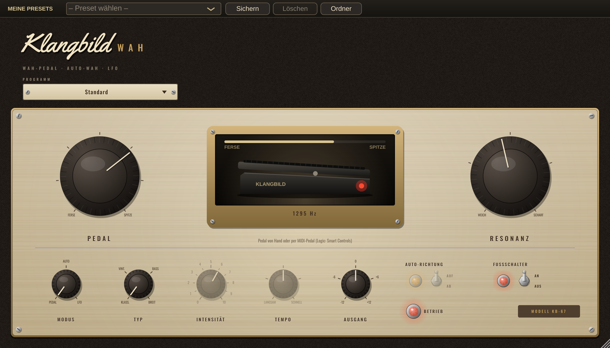

# Klangbild Wah

Wah-Pedal, Auto-Wah und LFO-Wah für Gitarre, Bass und Keys – Audio Unit für Logic Pro (außerdem VST3 und
Standalone), gebaut mit [JUCE](https://juce.com). Gehört vor das Amp-Profil (NAM) bzw. vor Drive und Fuzz.



## Bedienung

| Regler | Wirkung |
|---|---|
| **Pedal** | Pedalstellung von der Ferse (dunkel) bis zur Spitze (hell). Im Auto- und LFO-Modus die Grundstellung |
| **Resonanz** | Schärfe der Filterspitze – weich bis quäkend |
| **Modus** | *Pedal* (von Hand oder per MIDI-Pedal), *Auto* (der Anschlag öffnet das Wah), *LFO* (pendelt von selbst) |
| **Typ** | *Klassisch* (420 Hz–2,2 kHz), *Vintage* (italienisch, enger und vokaler), *Bass* (170 Hz–1,15 kHz), *Breit* (300 Hz–3,6 kHz) |
| **Intensität** | Auto: wie weit der Anschlag das Pedal bewegt · LFO: Hub |
| **Tempo** | Auto: Ansprache (langsam = weiches Atmen, schnell = Funk-Quaken) · LFO: 0,1–8 Hz |
| **Auto-Richtung** | AUF: Anschlag öffnet nach oben · AB: Anschlag schließt |
| **Fußschalter** | Wah an/aus – AUS ist bitgenau trocken |

Das Fenster zeigt das Pedal von der Seite: Die Wippe folgt der Stellung, darunter steht die aktuelle Filterfrequenz.

### Mit einem echten Expression-Pedal spielen
In Logic einem MIDI-Pedal (oder einem Controller-Fader) den Parameter **Pedal** zuweisen: *Smart Controls* öffnen,
einen Regler mit „Pedal“ belegen und *Lernen* wählen. Die Pedalbewegung wird intern geglättet, so knackt nichts.

### Presets
Standard · Halb offen – nasaler Solo-Ton · Vintage – vokal · Funk – Auto-Wah · Auto-Wah – weich · Auto-Wah abwärts ·
Bass – Envelope-Funk · LFO – langsam pendelnd · Orgel/Keys – breit

### Messwerte (48 kHz)
| Typ | Ferse | Mitte | Spitze | Spitzenanhebung |
|---|---|---|---|---|
| Klassisch | 413 Hz | 945 Hz | 2163 Hz | +8,5 dB |
| Vintage | 346 Hz | 816 Hz | 1922 Hz | +8,1 dB |
| Bass | 170 Hz | 438 Hz | 1129 Hz | +12,4 dB |
| Breit | 299 Hz | 1033 Hz | 3575 Hz | +6,4 dB |

Pegel bei halber Pedalstellung ±0,1 dB gegenüber trocken (alle Typen). Keine Latenz.

## Installation in Logic Pro

Am einfachsten über den [Klangbild-Installer](https://github.com/Guitoli1/KlangbildInstaller):

```bash
curl -fsSL https://raw.githubusercontent.com/Guitoli1/KlangbildInstaller/main/install.sh | bash
```

## Selbst bauen

```bash
cmake -B build -G Ninja -DCMAKE_BUILD_TYPE=Release
cmake --build build
```
